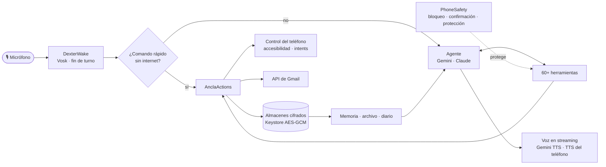

<p align="center">
  
</p>

<p align="center">
  
  
  
  
  
  
</p>

<p align="center">
  <a href="README.md">English</a> · <b>Español</b>
</p>

**Dexter** es una app de Android con un asistente de voz adentro: un búho gótico nocturno al que le hablas con *«Oye Dexter»* desde cualquier pantalla, como un Jarvis de bolsillo. Te ayuda a formar hábitos hasta que salgan solos, a planear los próximos tres años, a tener en orden tu dinero, tu correo y tus pendientes y, sobre todo, a ser más consciente de lo que haces y de cómo te sientes.

Es un proyecto personal que abarca diseño de producto, UX, un sistema de voz en tiempo real, un agente de IA con sus herramientas, seguridad y pruebas. Nació del proyecto de código abierto [Loop Habit Tracker](https://github.com/iSoron/uhabits), cuyo motor de hábitos conserva.

<p align="center">
  
  
  
  
</p>
<p align="center">
  
  
</p>
<p align="center"><sub>Hoy · Camino · Consciencia · Finanzas · Ahorro · imagen de roadmap: pantallas reales, dibujadas desde el código del app con datos de demostración, en su tema oscuro.</sub></p>

---

## Qué hace

<table>
<tr>
<td width="50%" valign="top">

### 🦉 Un asistente de voz que vive en el teléfono
- **Palabra de activación «Oye Dexter» sin internet** (Vosk), con filtro de volumen, confianza por palabra y una doble verificación con IA, para que la tele nunca lo despierte.
- **Conversa como una persona**: ves tus palabras mientras hablas, un gran botón **Enviar** con un anillo que se llena en las pausas (nunca te corta), empieza a hablar antes de terminar la respuesta y puedes **interrumpirlo hablando**.
- **Nunca se queda trabado**: los recordatorios y los comandos de todos los días se entienden **sin internet**, así funcionan aunque no haya conexión ni cupo de IA; si la IA está saturada, prueba varios modelos y te lo dice en voz alta.
- **Funciona en todas partes**: una tarjeta flotante sobre otras apps, un mosaico de ajustes rápidos, se inicia solo al prender el teléfono y le cede el micrófono a llamadas y notas de voz de WhatsApp.
- **Más de 60 herramientas** con Gemini o Claude: tareas, hábitos, metas, dinero, correo, notas, libros, alarmas, linterna, apps y ajustes del teléfono.

</td>
<td width="50%" valign="top">

### 🌱 Hábitos que se vuelven automáticos
- Basado en la investigación sobre hábitos: **intenciones de implementación** («después del café, medito»), una **versión de dos minutos** para los días difíciles, **días clave** (fallar dos veces seguidas es lo que rompe un hábito) y una autoevaluación semanal de **automaticidad** (SRBAI).
- **Hábitos y tareas por separado**: lo que repites cada día y lo que haces una sola vez.
- **Recordatorios al estilo Duolingo** cuatro veces al día, solo cuando hay algo pendiente, y cada uno termina con una pregunta que te trae al presente.
- **Recordatorios imposibles de ignorar**: una alarma a pantalla completa que suena y vibra hasta que tocas *Hecho* o *En 10 min* (con el teléfono bloqueado no muestra de qué se trata), y **fechas límite** que te avisan la noche anterior y esa mañana.
- El búho Dexter crece de semilla a árbol a medida que tus hábitos se afianzan.

</td>
</tr>
<tr>
<td valign="top">

### 🧭 Consciencia: la estrella del norte del app
- Una **pausa** para ponerle nombre exacto a lo que sientes (el medidor de ánimo RULER) y notar dónde vive en el cuerpo.
- Una **rueda semanal de seis dimensiones**, una pregunta de reflexión cada día y el **examen de la noche** (según Séneca e Ignacio de Loyola).
- **Meditaciones guiadas** con la voz tranquila de Dexter: respiración, escaneo del cuerpo, notar pensamientos y bondad amorosa, con silencios medidos y un cuenco tibetano sintetizado.
- Patrones de tus propios registros, como observaciones, nunca como puntajes.

</td>
<td valign="top">

### 🗺️ La vida en orden, por voz
- **Camino**: **roadmaps** a tres años, uno por área de tu vida (carrera, salud, dinero…), donde cada meta tiene su plan **WOOP** (Oettingen) armado con Dexter, sus hitos y una **imagen de roadmap** para ponerla de fondo de pantalla.
- **Finanzas**: «gasté 12 en almuerzo» registra el gasto; por **día, semana, mes o año**, presupuestos, lo que **ahorraste** cada mes y **metas de ahorro** que te dicen cuánto apartar.
- **Correo**: Gmail y la cuenta de Google de la universidad; Dexter resume la bandeja, redacta respuestas con tu estilo y limpia boletines por remitente.
- Una **frase de sabiduría** diaria de pensadores clásicos, herramientas de lectura y estudio, y más.

</td>
</tr>
</table>

### 🧠 Un mentor que recuerda
Dexter guarda **dos años de conversación**, cifrada en el teléfono, y la busca cuando mencionas algo del pasado. Al terminar cada día escribe un **diario** breve (temas, decisiones, cómo te notó) y aprende datos duraderos de tus propias palabras: personas, metas, estudios, rutinas, ordenados por tema. Ese contexto llega a cada conversación, así puede preguntarte *«¿cómo te fue en el examen del martes?»*.

---

## Seguridad y privacidad desde el diseño

Dexter puede leer tus mensajes, tu correo y tu pantalla, así que está hecho para que nada personal se filtre y nada irreversible pase sin ti:

| | |
|---|---|
| 🔐 **Todo cifrado** | Cada almacén (memoria, conversaciones, metas, dinero, cuentas de correo) usa AES-GCM con una clave que nunca sale del Android Keystore. |
| 🔒 **Teléfono bloqueado = nada personal** | Con la pantalla bloqueada, Dexter solo maneja volumen, música, alarmas y linterna; no revela ni recuerda nada. |
| ✋ **Un «sí» de verdad para lo riesgoso** | Enviar un correo, mandar correos a la papelera o borrar un hábito necesita tu confirmación en un mensaje *posterior*; el texto de pantallas, correos o archivos nunca puede confirmar. |
| 🛡️ **Protección contra inyección de instrucciones** | Todo lo que lee una herramienta (correos, WhatsApp, páginas, archivos) llega al modelo marcado como datos, nunca como órdenes, y los encabezados de correo no se pueden inyectar. |
| 🙈 **Pantallas privadas** | Bloqueo biométrico y ventanas seguras: sin capturas ni grabaciones, en blanco en recientes, y notificaciones ocultas en la pantalla de bloqueo. |
| 🔑 **Sin contraseñas** | El acceso a Gmail es con inicio de sesión de Google y un permiso revocable que no puede borrar para siempre; las claves viven en el Keystore. |

---

## Cómo funciona



| Capa | Tecnología |
|---|---|
| Interfaz | Kotlin, Jetpack Compose, Material 3, animaciones propias en Canvas (el búho, el camino, la rueda) |
| Voz | Vosk (activación y transcripción sin internet), AudioRecord con búfer circular, comprensión de audio de Gemini, Gemini TTS con respaldo en el teléfono |
| IA | Ciclos de herramientas de Gemini y Claude con un registro común; cambio de modelo ante límites; comandos rápidos sin llamar al modelo |
| Android | Servicio de micrófono en primer plano, ventana superpuesta, mosaico de ajustes rápidos, servicio de accesibilidad, lector de notificaciones, AlarmManager, idioma por app |
| Datos | El motor SQLite de hábitos de Loop (SQLCipher) y almacenes JSON cifrados con el Keystore |
| Integraciones | API REST de Gmail con autorización de Google Identity |
| Calidad | 188 pruebas unitarias (JUnit, kotlinx-coroutines-test) y pantallas reales dibujadas con Robolectric |

El código de Dexter está en [`uhabits-android/src/main/java/org/isoron/uhabits/ancla`](uhabits-android/src/main/java/org/isoron/uhabits/ancla): unas 25.000 líneas de Kotlin en 86 archivos, con sus pruebas en [`src/test/.../ancla`](uhabits-android/src/test/java/org/isoron/uhabits/ancla).

---

## Compilar y ejecutar

Necesitas JDK 17 y el Android SDK (API 36).

```bash
git clone https://github.com/tebl22/ancla-habitos.git
cd ancla-habitos
./gradlew :uhabits-android:installDebug     # compila e instala en un teléfono conectado
./gradlew :uhabits-android:testDebugUnitTest --tests "org.isoron.uhabits.ancla.*"   # pruebas de Dexter
```

El asistente usa tu propia clave de API (Gemini o Claude), guardada cifrada en el Keystore desde los ajustes de Dexter.

---

## Créditos y licencia

Dexter está construido sobre **[Loop Habit Tracker](https://github.com/iSoron/uhabits)** de Álinson Santos Xavier y sus colaboradores, de quienes conserva el motor de hábitos, los widgets y las estadísticas; su README original está en [`docs/LOOP_README.md`](docs/LOOP_README.md). Reconocimiento de voz sin internet con [Vosk](https://alphacephei.com/vosk/). Igual que Loop, Dexter es software libre bajo la [GNU GPL v3](LICENSE.txt).

<p align="center">
  <br/>
  <sub>Hecho por <a href="https://github.com/tebl22">Esteban</a></sub>
</p>
