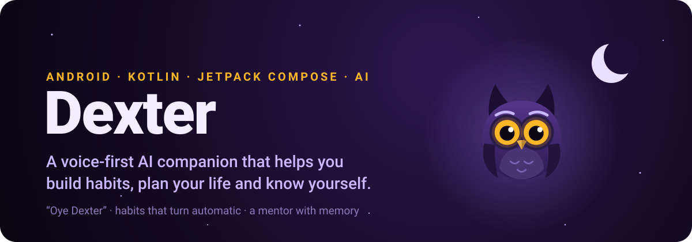
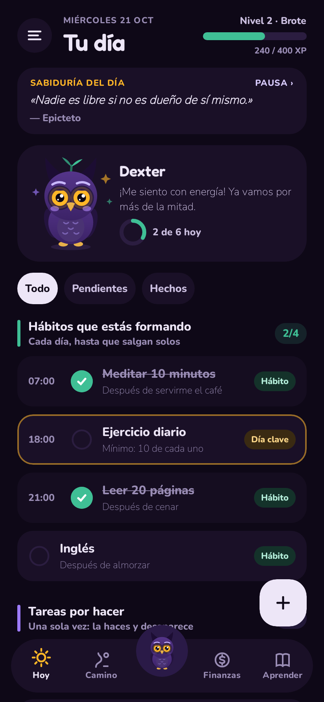
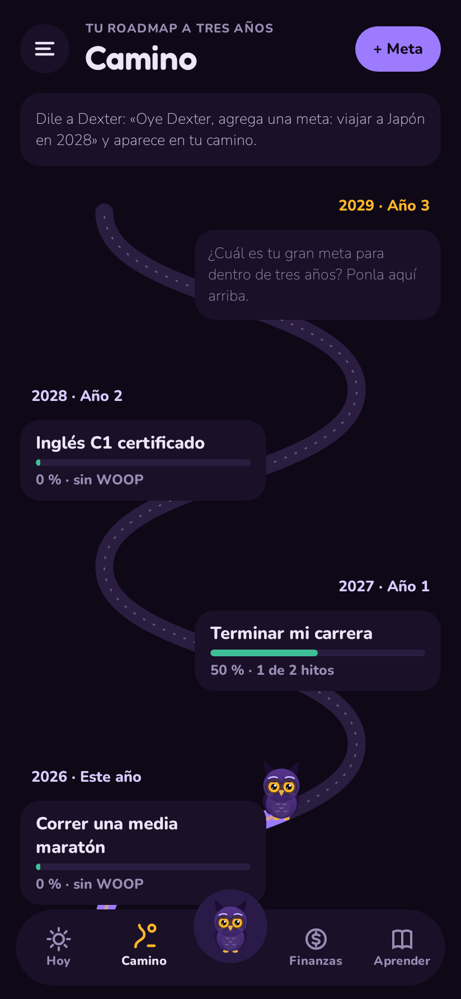
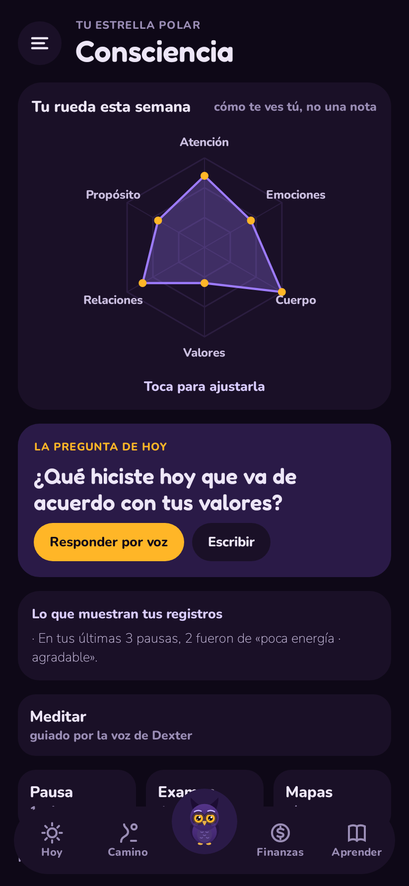
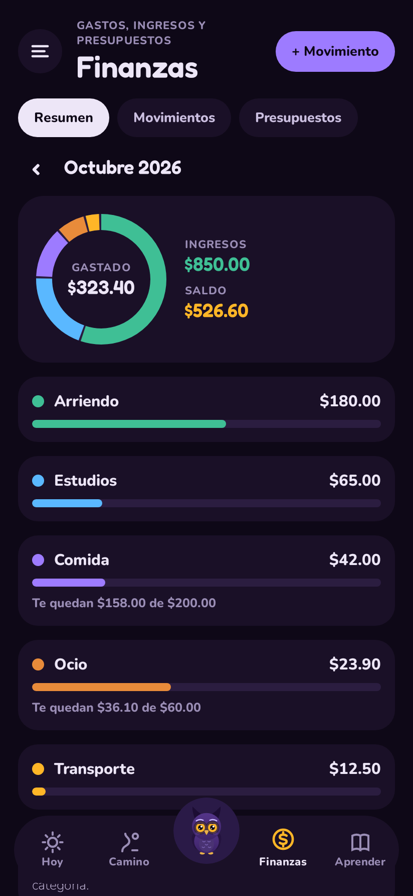
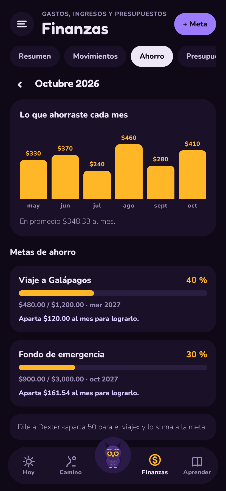
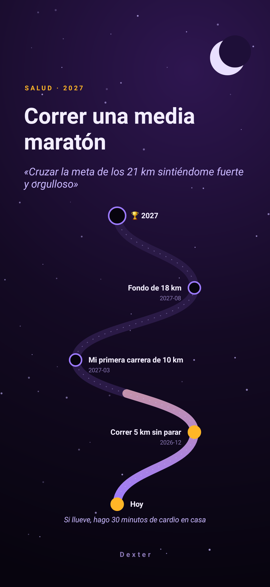
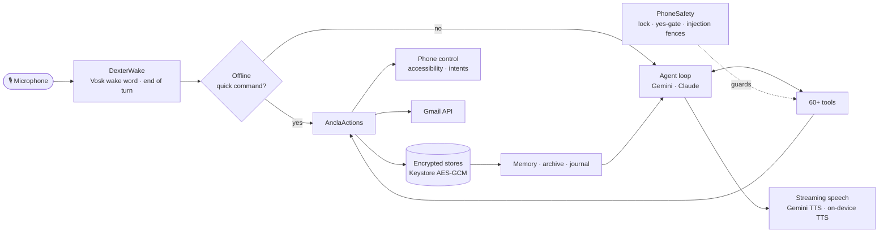
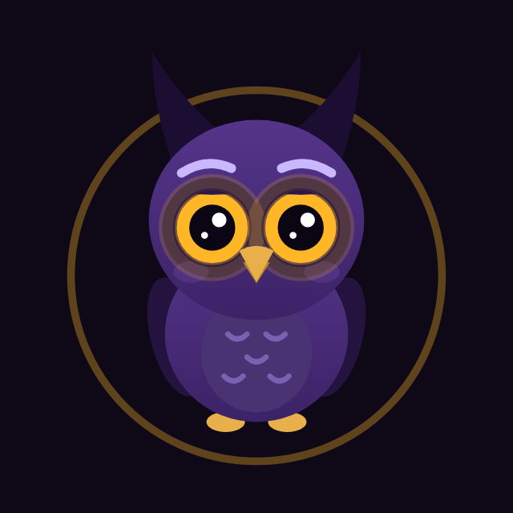

<p align="center">
  
</p>

<p align="center">
  
  
  
  
  
  
</p>

<h3 align="center">Your pocket Jarvis. Say <i>“Oye Dexter”</i> and your life gets organized.</h3>

<p align="center">
  <a href="../../releases/tag/dexter-ultima"></a>
</p>

<p align="center">
  <a href="#what-it-does">Features</a> ·
  <a href="#security-and-privacy-by-design">Privacy</a> ·
  <a href="#how-it-works">How it works</a> ·
  <a href="#build-and-run">Build</a>
  <br/>
  <b>English</b> · <a href="README.es.md">Español</a>
</p>

**Dexter** is an Android app with a voice assistant inside: a gothic night owl you talk to with *“Oye Dexter”*, from any screen, like a pocket Jarvis. It helps you build habits until they run on their own, plan the next three years, keep your money, mail and to-dos in order, and, above all, become more aware of what you do and how you feel.

It is a personal project that spans product design, UX, a real-time voice pipeline, an AI agent with its tools, security and testing. It grew from the open-source [Loop Habit Tracker](https://github.com/iSoron/uhabits), whose habit engine it keeps.

<p align="center">
  
  
  
  
</p>
<p align="center">
  
  
</p>
<p align="center"><sub>Hoy · Camino · Consciencia · Finanzas · Ahorro · a roadmap picture: real screens, rendered from the app's code with demo data, in its dark theme.</sub></p>

---

## What it does

<table>
<tr>
<td width="50%" valign="top">

### 🦉 A voice assistant that lives on the phone
- **“Oye Dexter” wake word, offline** (Vosk), with a loudness gate, word-confidence checks and an AI double-check, so a TV never wakes it.
- **Talks like a person**: live transcript while you speak, a big **Send** button with a ring that fills during pauses (it never cuts you off), streamed speech that starts before the answer is finished, and you can **talk over it** to interrupt.
- **Never stuck**: reminders and everyday commands are understood **offline**, so they work with no internet or AI quota; when the AI is saturated it retries several models and says so out loud.
- **Works everywhere**: a floating card over other apps, a Quick Settings tile, autostart on boot, and it gives the mic away to calls and WhatsApp voice notes.
- **60+ tools** through Gemini or Claude function calling: tasks, habits, goals, money, mail, notes, books, alarms, the flashlight, apps and phone settings.

</td>
<td width="50%" valign="top">

### 🌱 Habits that become automatic
- Built on habit research: **implementation intentions** (“after coffee, I meditate”), a **two-minute version** for hard days, **key days** (missing twice is what breaks a habit) and a weekly **automaticity** self-report (SRBAI).
- **Habits and to-dos kept apart**: what you repeat every day vs. what you do once.
- **Duolingo-style check-ins** four times a day, only when something is pending, each ending in a question that brings attention back to the present.
- **Reminders that can't be missed**: a full-screen alarm that rings and vibrates until *Done* or *In 10 min* (on a locked phone it hides what the task is), and **deadlines** that come up the evening before and that morning.
- Dexter the owl grows from seed to tree as your habits take hold.

</td>
</tr>
<tr>
<td valign="top">

### 🧭 Consciencia: the app's north star
- A **pause** that names the feeling precisely (the RULER mood meter) and where it lives in the body.
- A weekly **wheel of six dimensions**, a reflective question each day and the **night examen** (after Seneca and Ignatius).
- **Guided meditations** in Dexter's calm voice: breathing, body scan, noting and loving-kindness, with timed silences and a synthesized singing bowl.
- Patterns from your own records, shown as observations, never scores.

</td>
<td valign="top">

### 🗺️ Life admin, by voice
- **Camino**: three-year **roadmaps**, one per area of life (career, health, money…), where each goal gets a **WOOP** plan (Oettingen) built with Dexter and milestones, and a **roadmap picture** to set as your wallpaper.
- **Finanzas**: “gasté 12 en almuerzo” files an expense; by **day, week, month or year**, budgets, what you **saved** each month and **savings goals** that tell you how much to set aside.
- **Correo**: Gmail and a university Google account; Dexter summarizes the inbox, drafts replies in your voice and cleans newsletters by sender.
- A daily line of **wisdom** from classic thinkers, reading and study tools, and more.

</td>
</tr>
</table>

### 🧠 A mentor that remembers
Dexter keeps **two years of conversation**, encrypted on the phone, and searches it when you mention the past. After each day it writes a short **journal** (topics, decisions, how you seemed) and picks up lasting facts from your own words: people, goals, studies, routines, sorted by topic. That context reaches every conversation, so it can ask *“¿cómo te fue en el examen del martes?”*.

---

## Security and privacy by design

Dexter can read your messages, your mail and your screen, so it is built so that nothing personal leaks and nothing irreversible happens without you:

| | |
|---|---|
| 🔐 **Encrypted at rest** | Every store (memory, conversations, goals, money, mail accounts) is AES-GCM with a key that never leaves the Android Keystore. |
| 🔒 **Locked phone = no personal data** | With the screen locked, Dexter only controls volume, music, alarms and the flashlight; it never reveals or remembers anything. |
| ✋ **A real “yes” for risky actions** | Sending a mail, trashing mail or deleting a habit needs your confirmation in a *later* message; text from screens, mails or files can never confirm. |
| 🛡️ **Prompt-injection fencing** | Everything a tool reads (mails, WhatsApp, web pages, files) reaches the model marked as data, never instructions, and mail headers can't be injected. |
| 🙈 **Private screens** | Biometric app lock, and windows marked secure: no screenshots or recordings, blank in recents, and notifications hidden on the lock screen. |
| 🔑 **No passwords** | Gmail access is Google sign-in with a revocable token, under a scope that cannot delete for good; keys live in the Keystore. |

---

## How it works



| Layer | Technology |
|---|---|
| UI | Kotlin, Jetpack Compose, Material 3, custom Canvas animations (the owl, the path, the wheel) |
| Voice | Vosk (offline wake word and transcription), AudioRecord with a ring buffer, Gemini audio understanding, Gemini TTS with an on-device fallback |
| AI | Gemini and Claude tool-use loops sharing one tool registry; model fallback on rate limits; quick commands with no model call |
| Android | Foreground microphone service, overlay window, Quick Settings tile, accessibility service, notification listener, AlarmManager, per-app language |
| Data | Loop's SQLite habit engine (SQLCipher) plus Keystore-encrypted JSON stores with a version-checked cache |
| Integrations | Gmail REST API with Google Identity authorization |
| Quality | 188 unit tests (JUnit, kotlinx-coroutines-test), Robolectric renders of the real screens |

The Dexter code lives in [`uhabits-android/src/main/java/org/isoron/uhabits/ancla`](uhabits-android/src/main/java/org/isoron/uhabits/ancla): about 25,000 lines of Kotlin in 86 files, with tests in [`src/test/.../ancla`](uhabits-android/src/test/java/org/isoron/uhabits/ancla).

---

## Engineering highlights

- **Never falsely awake.** The wake word must pass four gates: a grammar-restricted recognizer, word confidence ≥ 0.75, a loudness gate fitted to the real microphone (measured on a Pixel 7), and an AI check of the recording. False wakes are dropped silently, and what follows them can never confirm an action.
- **Answers only when you're done.** A big "Send" button on the floating card ends the turn at once; without it, Dexter waits 3 s of silence (4.5 s when a sentence is left hanging, "pon una alarma para…"), and a ring on the button fills during the pause so you can see it coming and keep talking.
- **Shares the microphone politely.** It watches Android's active recordings and the audio mode, and steps aside during calls and voice notes instead of fighting for the mic.
- **Fast by default.** Everyday commands run offline in milliseconds; tool results that need no wording end the turn without a second model call; speech starts at the first sentence.
- **Tested where it matters**: wake-word gates, end of turn, the yes-gate, mail parsing and header injection, name matching, memory search, nudges, budgets, the WOOP model and more.

---

## Build and run

Requirements: JDK 17 and the Android SDK (API 36).

```bash
git clone https://github.com/tebl22/dexter-ai.git
cd dexter-ai
./gradlew :uhabits-android:installDebug     # build and install on a connected phone
./gradlew :uhabits-android:testDebugUnitTest --tests "org.isoron.uhabits.ancla.*"   # Dexter's tests
```

The assistant uses your own API key (Gemini or Claude), stored encrypted in the Keystore and entered in Dexter's settings. To render the README screenshots again:

```bash
DEXTER_SCREENSHOTS=1 ./gradlew :uhabits-android:testDebugUnitTest --tests "*ScreenshotsTest*"
```

---

## Credits and license

Dexter is built on **[Loop Habit Tracker](https://github.com/iSoron/uhabits)** by Álinson Santos Xavier and its contributors, whose habit engine, widgets and statistics it keeps; their original README is in [`docs/LOOP_README.md`](docs/LOOP_README.md). Offline speech recognition by [Vosk](https://alphacephei.com/vosk/). Like Loop, Dexter is free software under the [GNU GPL v3](LICENSE.txt).

<p align="center">
  <br/>
  <sub>Made by <a href="https://github.com/tebl22">Esteban</a></sub>
</p>
